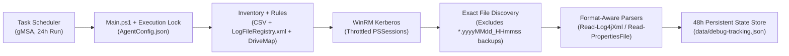
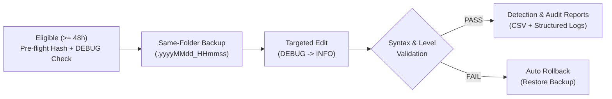

# Architecture — Blue Yonder TMS DEBUG Log Detection & Self-Healing Agent

## 1. System Overview

`TMS-Log-SelfHeal` is a centralized Windows PowerShell 5.1 automation agent executed on a management server via Windows Task Scheduler (every 24 hours) under a Group Managed Service Account (`gMSA`). It connects to remote Blue Yonder TMS Windows servers over WinRM (Kerberos), discovers exact logging configuration files defined in a centralized XML registry, detects `DEBUG` logger configurations, tracks their duration persistently, and optionally remediates loggers that remain in `DEBUG` for 48 hours or more.

## 2. Architecture Diagrams

### 2.1 Discovery, Parsing & 48-Hour Tracking Pipeline

### 2.2 Safe Remediation, Validation & Rollback Flow

## 3. End-to-End Execution Pipeline

1. **Initialization & Concurrency Guard (`src/Main.ps1`, `src/Common/`)**
   - Acquires a single-instance lockfile (`data/agent.lock`) to prevent overlapping scheduled runs.
   - Loads `config/AgentConfig.json` and initializes structured logging (`logs/`).
2. **Inventory & Configuration Load (`src/Discovery/`, `src/Configuration/`)**
   - Loads server inventory from CSV (`Inventory.SourceType = "File"`, with Splunk REST API ready for future activation), normalizes fields (`Customer`, `Hostname`, `ServerType`, `Environment`, `Status`), deduplicates hostnames, and applies filters.
   - Loads enabled components from `config/LogFileRegistry.xml` and drive rules from `config/ServerDriveMapping.json`.
3. **Drive Resolution & Remote Discovery (`src/Configuration/`, `src/Scanner/`)**
   - Resolves `{DRIVE}` per server (`PR*` -> `F:`, `DL*`/`FR*`/default -> `D:`).
   - Opens WinRM Kerberos sessions using the gMSA identity; logs `SERVER_UNAVAILABLE` and continues if a host is offline.
   - Expands wildcard paths remotely with strict exact filename/extension matching, excluding same-folder timestamped backup files.
4. **Parsing & DEBUG Detection (`src/Scanner/Parsers/`)**
   - Routes `.xml` files to `Read-Log4jXml.ps1` (Log4j 1.x & 2.x) and `.properties` files to `Read-PropertiesFile.ps1`.
   - Evaluates logger names against `<LoggerPatterns>` and flags unrecognized structures as `MANUAL_REVIEW_REQUIRED`.
5. **Persistent 48-Hour Tracking (`src/Tracking/`)**
   - Loads `data/debug-tracking.json`, keyed by `(Hostname, FilePath, LoggerName)`.
   - Retains `FirstDetectedUtc` across daily runs, marks `ELIGIBLE` at `>= 48` hours, closes records when changed to `INFO`, marks `INACTIVE` if missing, and preserves timestamps when a server is offline.
   - **Timing Limitation**: Because scans run every 24 hours, the 48-hour clock starts at *first detection* rather than the exact moment `DEBUG` was enabled.
6. **Safe Remediation & Rollback (`src/Remediation/`)**
   - Runs only if `DryRun -eq $false` and `EnableRemediation -eq $true`.
   - Re-verifies file hash and `DEBUG` state, creates a same-folder backup (`<filename>.yyyyMMdd_HHmmss`), updates only the targeted logger to `INFO`, validates syntax, and rolls back automatically on failure—without restarting TMS services or touching runtime logs.
7. **Reporting & Audit (`src/Reporting/`)**
   - Writes consolidated `DetectionReport_*.csv`, `RemediationAudit_*.csv`, and structured execution logs (`logs/`).

## 4. Persistent Storage Design Evaluation

| Option | Pros | Cons | Recommendation |
|---|---|---|---|
| **Structured JSON (`data/debug-tracking.json`)** | Zero third-party dependencies; native to PS 5.1; human-inspectable; atomic write + `.bak` rotation | Single-writer only (mitigated by `agent.lock`) | **Recommended Default** for centralized single-scheduler execution |
| **CSV** | Easy to open in Excel | Poor support for nested metadata and schema evolution | Not recommended for primary state |
| **SQLite** | ACID transactions | Requires third-party binaries/modules (`PSSQLite`), violating zero-dependency goal | Optional future upgrade |
| **SQL Server** | Multi-writer enterprise scale | Requires external DB provisioning | Optional future upgrade via `System.Data.SqlClient` |
